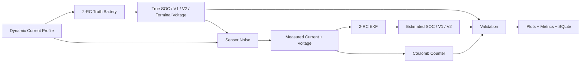

# EV Battery Digital Twin & State Estimation Platform

[](https://github.com/savbcar/battery-digital-twin/actions/workflows/ci.yml)

A portfolio-grade battery-modeling and SOC-estimation project built to connect
battery physics, state-space modeling, Extended Kalman Filtering, numerical
validation and engineering software practices.

## What this project demonstrates

- 1-RC and 2-RC Thevenin equivalent-circuit models
- nonlinear OCV-SOC relationship
- exact zero-order-hold discretization
- dynamic discharge / regenerative-charge current profiles
- synthetic ground-truth SOC and terminal voltage
- noisy current and voltage sensors
- manual NumPy Extended Kalman Filter
- Coulomb-counting baseline
- SOC and voltage error metrics
- initial-SOC convergence testing
- Q/R, parameter, capacity and noise sensitivity studies
- automated physics/unit/integration tests
- SQLite simulation-run logging
- Docker
- GitHub Actions CI
- MATLAB 2-RC simulator and EKF
- programmatic Simulink 1-RC model generation

## Architecture



## Governing equations

Positive current is **discharge**.

### SOC

\[
\dot z = -\frac{I}{Q}
\]

For capacity in Ah:

\[
z_{k+1} = z_k - \frac{\Delta t}{3600Q_{Ah}} I_k
\]

### 1-RC model

\[
\dot V_1 =
-\frac{V_1}{R_1C_1}+\frac{I}{C_1}
\]

\[
V_t = OCV(z)-IR_0-V_1
\]

Exact zero-order-hold discretization:

\[
\alpha_1=e^{-\Delta t/(R_1C_1)}
\]

\[
V_{1,k+1}=
\alpha_1 V_{1,k}
+R_1(1-\alpha_1)I_k
\]

### 2-RC model

\[
\dot V_2 =
-\frac{V_2}{R_2C_2}+\frac{I}{C_2}
\]

\[
V_t=OCV(z)-IR_0-V_1-V_2
\]

The state is

\[
x=[z,V_1,V_2]^T
\]

and the measurement model is nonlinear because `OCV = f(SOC)`.

## Why EKF?

A linear Kalman filter assumes a linear measurement equation. Terminal voltage
depends nonlinearly on SOC through the OCV-SOC relationship. The EKF linearizes
that relationship locally using

\[
H=[dOCV/dSOC,-1,-1]
\]

while propagating the state covariance and applying voltage-based corrections.

## Quick start

### Windows PowerShell

```powershell
git clone <YOUR-REPO-URL>
cd battery-digital-twin

py -3.12 -m venv .venv
.\.venv\Scripts\Activate.ps1

python -m pip install --upgrade pip
pip install -e ".[dev]"

pytest
battery-twin all
```

### Linux / WSL

```bash
python3 -m venv .venv
source .venv/bin/activate
python -m pip install --upgrade pip
pip install -e ".[dev]"
pytest
battery-twin all
```

Outputs are written to:

```text
results/generated/baseline/
results/generated/sensitivity/
results/battery_runs.db
```

## Docker

```bash
docker build -t battery-digital-twin .
docker run --rm -v "${PWD}/results:/app/results" battery-digital-twin all
```

or:

```bash
docker compose up --build
```

## Validation philosophy

Synthetic data is used first because true internal states are known exactly.
The estimator intentionally uses slightly mismatched parameters and starts with
incorrect SOC. This tests convergence rather than giving the EKF the same
perfect model that generated the data.

Reported metrics include:

- SOC RMSE
- SOC MAE
- maximum absolute SOC error
- steady-state SOC MAE
- final SOC error
- convergence time to a 2 percentage-point error band held for 60 s
- terminal-voltage RMSE / MAE
- innovation mean and standard deviation

## Sensitivity studies

`battery-twin studies` sweeps:

- initial SOC
- process-noise covariance scale Q
- voltage measurement covariance scale R
- R0 mismatch
- capacity mismatch
- voltage sensor noise

Every sweep writes a CSV plus an engineering plot.

## MATLAB

Open MATLAB in the `matlab/` folder.

```matlab
run_demo
```

This independently implements the 2-RC model and manual EKF.

To generate the Simulink artifact:

```matlab
build_simulink_1rc
```

This creates:

```text
battery_1rc_generated.slx
```

from inspectable primitive Simulink blocks.

## SQL

Simulation runs are stored in SQLite.

Example query:

```sql
SELECT
    r.created_utc,
    r.tag,
    m.metric_name,
    m.metric_value
FROM simulation_runs r
JOIN run_metrics m ON m.run_id = r.run_id
ORDER BY r.created_utc DESC;
```

## Assumptions

1. Positive current means discharge.
2. Capacity is constant within a run.
3. ECM parameters are constant within a run.
4. OCV depends only on SOC in the baseline model.
5. Temperature and hysteresis are omitted.
6. Current is piecewise constant over each sample interval.
7. Sensor noises are independent zero-mean Gaussian signals in the synthetic benchmark.
8. RC elements are lumped phenomenological approximations, not one-to-one physical electrochemical components.

## What the RC terms physically mean

`R0` captures fast approximately-ohmic losses.

The RC branches capture transient polarization behavior over characteristic time
scales `tau = R*C`. They may reflect combined effects of charge-transfer,
double-layer and diffusion-related dynamics; they should not be described as
literal one-to-one electrochemical components.

## Limitations

This is an engineering portfolio project, not a production BMS.

A production implementation would require substantial additional work including
temperature dependence, hysteresis, aging/SOH, cell variation, online parameter
adaptation, current-bias estimation, embedded numerical constraints,
observability analysis, diagnostics, functional-safety processes and measured
vehicle/cell validation.

## Verified deterministic benchmark

The packaged baseline was executed before release with a 15 percentage-point
initial SOC error (truth 85%, EKF 70%) and intentional estimator parameter
mismatch.

- SOC RMSE: **0.446%**
- SOC MAE: **0.299%**
- convergence to ±2 percentage points for 60 s: **15 s**
- coulomb-counting SOC RMSE: **14.614%**
- reconstructed-voltage RMSE: **2.453 mV**

These are synthetic-benchmark results, not claims of production-cell accuracy.
See `docs/RESULTS.md`.

### SOC estimation

The EKF is deliberately initialized 15 percentage points away from the true SOC.
Voltage feedback rapidly corrects the state estimate, whereas pure coulomb
counting retains the initial offset because it has no absolute measurement
correction.


### Terminal-voltage validation

The reconstructed terminal voltage tracks the 2-RC truth model under dynamic
discharge and regenerative-current loading.


### EKF innovation

The large initial innovation is caused by deliberate state-initialization error.
After convergence, the innovation fluctuates around approximately zero.


### Polarization-state estimation

The two RC states reproduce faster and slower transient polarization dynamics.


### Capacity-mismatch sensitivity

SOC accuracy was evaluated under deliberate usable-capacity mismatch.


### MATLAB implementation

The same 2-RC state-space and EKF equations were independently implemented in
MATLAB.


### Simulink implementation

An inspectable discrete 1-RC state model was generated from primitive Simulink
blocks to make the numerical state update transparent.


## CV bullets based on the verified packaged benchmark

- Developed 1-RC/2-RC lithium-ion equivalent-circuit digital twins and a manual
  Extended Kalman Filter for SOC estimation using Python and MATLAB; achieved
  **0.45% SOC RMSE** in a deterministic synthetic
  2-RC benchmark with a **15 percentage-point initial SOC error**.
- Evaluated robustness to initial-state error, Q/R covariance, ECM and capacity
  mismatch, current/voltage sensor noise and sampling interval; automated
  validation with pytest, GitHub Actions, SQLite run logging and Docker.
- Implemented exact zero-order-hold battery-state discretization and generated
  an inspectable discrete 1-RC Simulink model programmatically for cross-platform
  model development.


## Public measured-data extension

See `docs/NASA_DATA.md`.

The NASA battery dataset is intentionally **not bundled** into this repository.
The default benchmark remains deterministic and reproducible.

## Repository layout

```text
battery-digital-twin/
├── configs/
├── data/
├── docs/
├── matlab/
├── results/
├── sql/
├── src/battery_twin/
│   ├── data/
│   ├── database/
│   ├── estimators/
│   ├── models/
│   ├── simulation/
│   └── validation/
├── tests/
├── .github/workflows/
├── Dockerfile
├── docker-compose.yml
├── pyproject.toml
└── README.md
```

## Interview-ready design decisions

**Why 1-RC first?**  
It gives the smallest model that captures both instantaneous ohmic loss and one
dynamic polarization time scale.

**Why 2-RC afterwards?**  
A second RC state adds another characteristic transient time scale and can reduce
voltage-model error when one RC branch is too restrictive.

**Why exact ZOH discretization?**  
For constant input over a sample, the linear RC ODE has a closed-form solution.
Using it avoids Euler-discretization error at essentially no extra runtime cost.

**Why is SOC a state?**  
It evolves dynamically through charge balance and cannot be directly measured.

**Why EKF?**  
The OCV-SOC map makes the terminal-voltage observation nonlinear.

**What are Q and R?**  
Q models state-transition uncertainty; R models measurement uncertainty.

**What can make the EKF diverge?**  
Poor initialization, severe parameter mismatch, incorrect current sign,
unrepresentative Q/R, weak voltage sensitivity to SOC, numerical covariance
problems, biased sensors or an invalid OCV curve.

## CV bullets — fill only after running your own benchmark

Do not publish fabricated numbers. After running `battery-twin all`, use the
generated `metrics.json`.

Example truthful structure:

- Developed and validated 1-RC/2-RC lithium-ion equivalent-circuit models and a
  manual Extended Kalman Filter for SOC estimation under dynamic load profiles
  using Python and MATLAB.
- Quantified robustness to initial-state error, process/measurement covariance,
  parameter mismatch, capacity error and sensor noise; automated regression
  testing and simulation logging with pytest, GitHub Actions, SQLite and Docker.
- Cross-implemented battery state dynamics and EKF estimation in MATLAB and
  generated an inspectable discrete Simulink 1-RC model programmatically.
