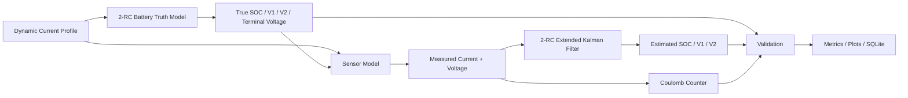
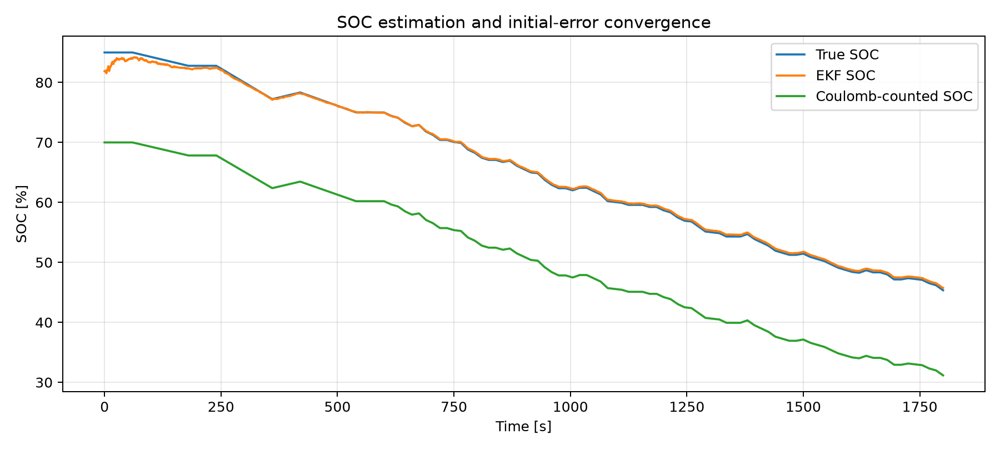
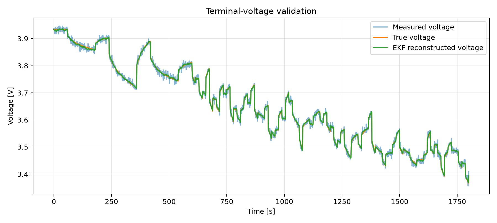
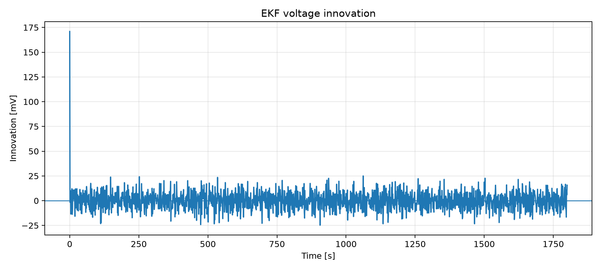
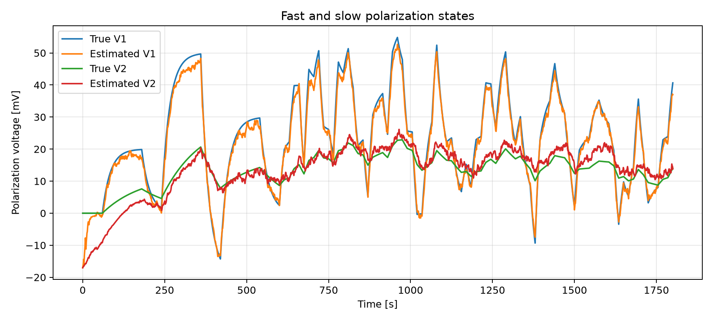
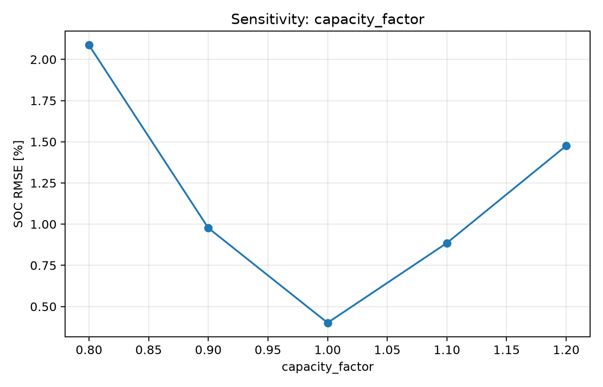
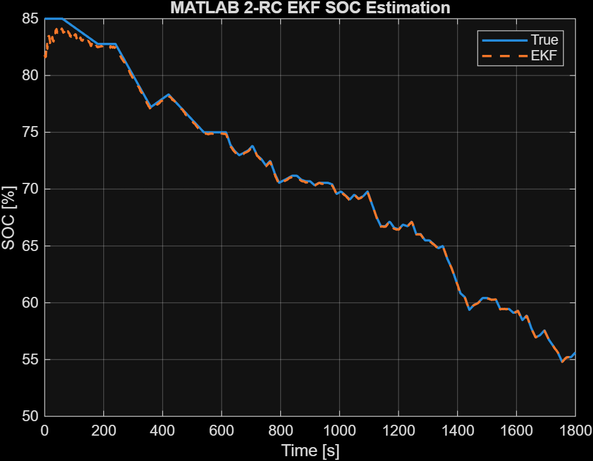
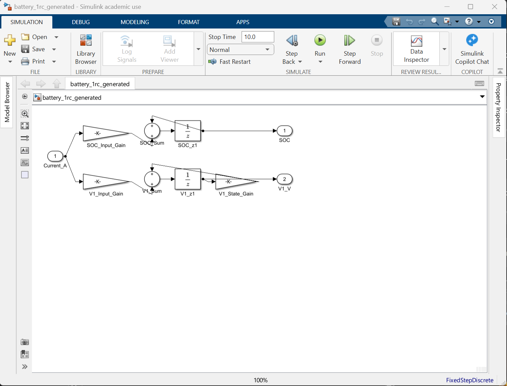

# EV Battery Digital Twin & State Estimation Platform

[](https://github.com/savbcar/battery-digital-twin/actions/workflows/ci.yml)

Physics-based lithium-ion battery modeling and State-of-Charge estimation using equivalent-circuit models, Extended Kalman Filtering, MATLAB/Simulink, automated validation, Docker, SQLite, and continuous integration.

---

## Overview

This project implements a reproducible EV battery digital-twin and state-estimation workflow centered on lithium-ion equivalent-circuit modeling and Extended Kalman Filtering.

The engineering workflow progresses from a first-order 1-RC Thevenin model to a 2-RC model with multiple polarization time scales, then formulates the system in discrete state-space form for SOC estimation using a manually implemented Extended Kalman Filter.

The project includes:

- 1-RC and 2-RC Thevenin equivalent-circuit battery models
- nonlinear OCV-SOC relationship
- exact zero-order-hold discretization
- dynamic discharge and regenerative-current profiles
- synthetic ground-truth SOC and terminal voltage
- noisy current and voltage measurement models
- Coulomb-counting SOC baseline
- manual NumPy Extended Kalman Filter
- SOC and terminal-voltage validation
- initial-state convergence analysis
- model-parameter and sensor-noise sensitivity studies
- MATLAB implementation of the 2-RC plant and EKF
- programmatically generated Simulink 1-RC model
- automated unit and integration testing
- SQLite experiment logging
- Docker-based reproducibility
- GitHub Actions continuous integration

---

## System Architecture



The plant, sensors, estimator, and validation layers are deliberately separated so that model mismatch and measurement uncertainty can be introduced independently.

---

## Battery Model

The project uses a Thevenin equivalent-circuit representation of a lithium-ion cell.

The sign convention is:

- positive current: discharge
- negative current: charge / regenerative current

### State of Charge

SOC is represented as normalized remaining charge:

$$
z = \frac{q}{Q}
$$

With positive current defined as discharge:

$$
\frac{dz}{dt} = -\frac{I}{Q}
$$

For capacity specified in ampere-hours:

$$
z_{k+1}
=
z_k
-
\frac{\Delta t}{3600Q_{Ah}} I_k
$$

The factor 3600 converts ampere-hours to coulombs.

---

## 1-RC Thevenin Model

The first-order model contains:

- open-circuit voltage \(OCV(z)\)
- ohmic resistance \(R_0\)
- one polarization branch \(R_1 \parallel C_1\)

The polarization-state dynamics are

$$
\frac{dV_1}{dt}
=
-\frac{V_1}{R_1C_1}
+
\frac{I}{C_1}
$$

and terminal voltage is

$$
V_t
=
OCV(z)
-
IR_0
-
V_1
$$

The characteristic polarization time constant is

$$
\tau_1 = R_1C_1
$$

### Exact discrete-time form

Assuming current is constant over each sampling interval,

$$
\alpha_1
=
e^{-\Delta t/(R_1C_1)}
$$

and

$$
V_{1,k+1}
=
\alpha_1 V_{1,k}
+
R_1(1-\alpha_1)I_k
$$

The exact zero-order-hold solution is used instead of forward Euler integration to avoid unnecessary discretization error.

---

## 2-RC Thevenin Model

A second polarization branch is added to represent an additional dynamic time scale:

$$
\frac{dV_2}{dt}
=
-\frac{V_2}{R_2C_2}
+
\frac{I}{C_2}
$$

Terminal voltage becomes

$$
V_t
=
OCV(z)
-
IR_0
-
V_1
-
V_2
$$

The state vector is

$$
x =
\begin{bmatrix}
z \\
V_1 \\
V_2
\end{bmatrix}
$$

The two RC branches provide independent fast and slow polarization states.

They are treated as lumped phenomenological states rather than one-to-one representations of individual electrochemical mechanisms.

---

## Discrete State-Space Model

For sampling interval \(\Delta t\),

$$
\alpha_1 = e^{-\Delta t/(R_1C_1)}
$$

$$
\alpha_2 = e^{-\Delta t/(R_2C_2)}
$$

The state transition can be written as

$$
x_{k+1}
=
Fx_k
+
BI_k
+
w_k
$$

with

$$
F =
\begin{bmatrix}
1 & 0 & 0 \\
0 & \alpha_1 & 0 \\
0 & 0 & \alpha_2
\end{bmatrix}
$$

and

$$
B =
\begin{bmatrix}
-\frac{\Delta t}{Q} \\
R_1(1-\alpha_1) \\
R_2(1-\alpha_2)
\end{bmatrix}
$$

The voltage measurement model is

$$
V_k
=
OCV(z_k)
-
I_kR_0
-
V_{1,k}
-
V_{2,k}
+
v_k
$$

The state transition is linear for constant model parameters, while the measurement equation is nonlinear because of the nonlinear OCV-SOC relationship.

---

## Extended Kalman Filter

A standard linear Kalman filter is insufficient because terminal voltage depends nonlinearly on SOC through the OCV-SOC map.

The EKF prediction step is

$$
\hat{x}_k^{-}
=
F\hat{x}_{k-1}^{+}
+
BI_{k-1}
$$

$$
P_k^{-}
=
FP_{k-1}^{+}F^T
+
Q
$$

The voltage prediction is

$$
\hat{V}_k
=
OCV(\hat{z}_k)
-
I_kR_0
-
\hat{V}_{1,k}
-
\hat{V}_{2,k}
$$

The measurement Jacobian is

$$
H_k
=
\begin{bmatrix}
\frac{dOCV}{dz} &
-1 &
-1
\end{bmatrix}
$$

The innovation is

$$
y_k
=
V_k
-
\hat{V}_k
$$

with innovation covariance

$$
S_k
=
H_kP_k^{-}H_k^T
+
R
$$

and Kalman gain

$$
K_k
=
P_k^{-}H_k^TS_k^{-1}
$$

The state correction is

$$
\hat{x}_k^{+}
=
\hat{x}_k^{-}
+
K_ky_k
$$

The covariance update uses the Joseph stabilized form:

$$
P_k^{+}
=
(I-K_kH_k)P_k^{-}(I-K_kH_k)^T
+
K_kRK_k^T
$$

This form improves numerical robustness and helps preserve covariance symmetry and positive semidefiniteness.

---

## OCV-SOC Model

The baseline uses a smooth synthetic nonlinear OCV-SOC relationship.

This is intentional: the purpose of the baseline is algorithm development and estimator validation with known ground truth rather than identification of a particular commercial cell.

The OCV derivative is implemented analytically because

$$
\frac{dOCV}{dSOC}
$$

directly enters the EKF measurement Jacobian.

A measured-cell implementation should replace the synthetic relation with experimentally derived characterization data or an interpolated OCV lookup table.

---

## Validation Strategy

Synthetic data is used first because all internal states are known exactly.

The estimator is deliberately not given the exact plant used to generate the data. The baseline includes:

- incorrect initial SOC
- current measurement noise
- voltage measurement noise
- intentional battery-parameter mismatch

This prevents the estimator from being evaluated under an unrealistically perfect-model scenario.

The following metrics are calculated:

- SOC RMSE
- SOC MAE
- maximum absolute SOC error
- final SOC error
- steady-state SOC MAE
- convergence time
- terminal-voltage RMSE
- terminal-voltage MAE
- innovation mean
- innovation standard deviation

---

## Verified Baseline Results

The deterministic baseline uses:

- true initial SOC: **85%**
- EKF initial SOC: **70%**
- initial SOC error: **15 percentage points**
- 2-RC truth model
- 2-RC EKF estimator
- deliberate plant/estimator parameter mismatch
- noisy current and voltage measurements

| Metric | Result |
|---|---:|
| SOC RMSE | **0.446%** |
| SOC MAE | **0.299%** |
| Maximum absolute SOC error | **3.471%** |
| Final SOC error | **0.396%** |
| Steady-state SOC MAE | **0.314%** |
| Convergence to ±2 percentage points for 60 s | **15 s** |
| Coulomb-counting SOC RMSE | **14.614%** |
| Terminal-voltage RMSE | **2.453 mV** |
| Terminal-voltage MAE | **1.963 mV** |
| Innovation mean | **0.137 mV** |
| Innovation standard deviation | **9.236 mV** |

These values correspond to the deterministic synthetic benchmark and are not claims of production-cell accuracy.

Detailed results are documented in [`docs/RESULTS.md`](docs/RESULTS.md).

---

## SOC Estimation

The EKF is intentionally initialized 15 percentage points below the true SOC.

Voltage feedback rapidly corrects the state estimate, while pure Coulomb counting retains most of the initialization error because it has no absolute measurement correction.



---

## Terminal-Voltage Validation

The reconstructed voltage tracks the 2-RC truth model under dynamic discharge and regenerative-current operation.



---

## EKF Innovation

The initial innovation is large because of the deliberate SOC initialization error.

Following convergence, the innovation fluctuates around approximately zero.



---

## Polarization-State Estimation

The EKF simultaneously estimates the fast and slow polarization states in addition to SOC.



---

## Sensitivity and Robustness Analysis

The automated sensitivity framework evaluates estimator behavior across **59 controlled runs**.

The study covers:

- initial SOC error
- process-noise covariance \(Q\)
- measurement-noise covariance \(R\)
- \(R_0\) mismatch
- \(R_1\) mismatch
- \(C_1\) mismatch
- \(R_2\) mismatch
- \(C_2\) mismatch
- usable-capacity mismatch
- voltage sensor noise
- current sensor noise
- sampling interval

Each sweep generates quantitative metrics and an engineering plot.

Example — capacity mismatch:



Sensitivity results are written to:

```text
results/generated/sensitivity/
```

---

## MATLAB Implementation

The battery dynamics and EKF are independently implemented in MATLAB.

The MATLAB implementation includes:

- 2-RC battery-state simulation
- nonlinear OCV-SOC relation
- exact discrete-time state propagation
- manual EKF prediction and correction
- Joseph covariance update
- SOC and terminal-voltage visualization

From the `matlab/` directory:

```matlab
run_demo
```

Example MATLAB SOC-estimation result:



---

## Simulink Implementation

A transparent discrete 1-RC battery model is generated programmatically using primitive Simulink blocks.

Run:

```matlab
build_simulink_1rc
```

This generates:

```text
battery_1rc_generated.slx
```

The model explicitly represents:

- SOC state propagation
- RC polarization-state propagation
- input gains
- state feedback
- discrete Unit Delay blocks

The model intentionally avoids a black-box battery block so that the numerical state update remains directly inspectable.



The EKF itself is implemented in Python and MATLAB; the current Simulink artifact represents the 1-RC battery state dynamics rather than a complete Simulink EKF implementation.

---

## Software Architecture

```text
battery-digital-twin/
├── .github/
│   └── workflows/
│       └── ci.yml
├── configs/
│   └── default.yaml
├── data/
│   └── public/
├── docs/
│   ├── images/
│   ├── ENGINEERING_NOTES.md
│   ├── NASA_DATA.md
│   └── RESULTS.md
├── matlab/
│   ├── battery_1rc_generated.slx
│   ├── battery_params.m
│   ├── build_simulink_1rc.m
│   ├── ekf_soc_2rc.m
│   ├── ocv_from_soc.m
│   ├── run_demo.m
│   └── simulate_2rc.m
├── results/
├── sql/
│   └── schema.sql
├── src/
│   └── battery_twin/
│       ├── data/
│       ├── database/
│       ├── estimators/
│       ├── models/
│       ├── simulation/
│       └── validation/
├── tests/
├── Dockerfile
├── docker-compose.yml
├── pyproject.toml
├── requirements.txt
└── README.md
```

---

## Installation

### Linux / WSL

```bash
git clone https://github.com/savbcar/battery-digital-twin.git
cd battery-digital-twin

python3 -m venv .venv
source .venv/bin/activate

python -m pip install --upgrade pip
pip install -e ".[dev]"
```

Run the test suite:

```bash
pytest
```

Run the complete project:

```bash
battery-twin all
```

---

### Windows PowerShell

```powershell
git clone https://github.com/savbcar/battery-digital-twin.git
cd battery-digital-twin

py -3.12 -m venv .venv
.\.venv\Scripts\Activate.ps1

python -m pip install --upgrade pip
pip install -e ".[dev]"

pytest
battery-twin all
```

---

## CLI

Run only the baseline:

```bash
battery-twin baseline
```

Run only the sensitivity studies:

```bash
battery-twin studies
```

Run the complete workflow:

```bash
battery-twin all
```

Generated outputs are written to:

```text
results/generated/baseline/
results/generated/sensitivity/
results/battery_runs.db
```

---

## Automated Testing

The project includes physics-oriented unit and integration tests covering:

- SOC sign convention
- charge/discharge behavior
- exact RC relaxation
- long-pulse steady-state polarization
- OCV derivative verification
- 2-RC time constants
- covariance symmetry
- covariance positive semidefiniteness
- SOC bounds
- end-to-end EKF convergence

Run locally with:

```bash
pytest
```

Static analysis:

```bash
ruff check src tests
```

---

## Continuous Integration

GitHub Actions executes automatically on pushes and pull requests.

The CI pipeline performs:

1. repository checkout
2. Python environment setup
3. package installation
4. Ruff static analysis
5. pytest test execution
6. baseline simulation smoke test

Workflow status is displayed by the badge at the top of this README.

---

## Docker

Build the image:

```bash
docker build -t battery-digital-twin .
```

Run the complete platform:

```bash
docker run --rm \
  -v "$(pwd)/results:/app/results" \
  battery-digital-twin all
```

Docker Compose is also supported:

```bash
docker compose up --build
```

The `results/` bind mount preserves generated outputs outside the container.

---

## Experiment Logging

Simulation runs are logged to SQLite.

The database stores:

- unique run identifier
- UTC timestamp
- run tag
- complete configuration
- validation metrics

Example query:

```sql
SELECT
    r.created_utc,
    r.tag,
    m.metric_name,
    m.metric_value
FROM simulation_runs r
JOIN run_metrics m
    ON m.run_id = r.run_id
ORDER BY r.created_utc DESC;
```

This provides traceability between model configuration and resulting performance.

---

## Configuration

The default experiment is defined in:

```text
configs/default.yaml
```

It contains:

- simulation duration
- sampling interval
- random seed
- true initial SOC
- estimator initial SOC
- sensor-noise levels
- truth-model parameters
- estimator-model parameters
- EKF \(Q\), \(R\), and initial covariance values

The use of a deterministic seed makes the baseline reproducible.

---

## Public Measured-Data Extension

The baseline intentionally uses synthetic data for controlled estimator verification.

A measured-data extension is documented in:

[`docs/NASA_DATA.md`](docs/NASA_DATA.md)

The repository includes a CSV adapter for normalized time/current/voltage data.

A measured-cell workflow would additionally require:

1. current-polarity verification
2. usable-capacity identification
3. measured OCV-SOC characterization
4. ECM parameter identification
5. temperature handling
6. reference-SOC definition
7. validation against independent experimental data

Public battery datasets are not bundled with the repository.

---

## Assumptions

The baseline model assumes:

1. positive current corresponds to discharge
2. usable capacity remains constant within a simulation
3. ECM parameters remain constant within a simulation
4. OCV depends only on SOC
5. temperature dependence is neglected
6. hysteresis is neglected
7. current is constant within each discrete sampling interval
8. sensor noise is modeled as independent zero-mean Gaussian noise
9. RC branches are lumped approximations of aggregate electrochemical polarization behavior

---

## Limitations

This project is an engineering modeling and state-estimation platform, not a production Battery Management System.

A production implementation would require additional development including:

- temperature-dependent ECM parameters
- OCV hysteresis
- State-of-Health estimation
- usable-capacity adaptation
- resistance aging
- cell-to-cell variation
- current-sensor bias estimation
- online parameter identification
- thermal-state estimation
- observability analysis
- fault detection and diagnostics
- embedded numerical constraints
- pack-level estimation
- extensive measured-cell validation
- safety mechanisms and functional-safety development

---

## Engineering Design Decisions

### Why use a 1-RC model first?

The 1-RC model is the smallest commonly used ECM that captures both an instantaneous ohmic voltage drop and a dynamic polarization response.

### Why extend to 2-RC?

A second RC branch introduces another characteristic time scale and allows the model to represent both faster and slower transient voltage behavior.

### Why use exact zero-order-hold discretization?

The linear RC differential equations have closed-form solutions for piecewise-constant current. Exact discretization therefore removes Euler integration error at negligible additional computational cost.

### Why is SOC a state?

SOC evolves dynamically through charge balance but is not directly measurable with a conventional sensor.

### Why use an EKF rather than a linear Kalman filter?

The battery voltage measurement depends nonlinearly on SOC through the OCV-SOC relationship. The EKF handles this by locally linearizing the measurement model.

### What do \(Q\) and \(R\) represent?

- \(Q\): uncertainty in the state-transition model
- \(R\): uncertainty in the measurement model

Their values influence the balance between model prediction and voltage-based correction.

### What can cause estimator divergence?

Potential causes include:

- incorrect current sign convention
- severe ECM parameter mismatch
- incorrect OCV-SOC relationship
- excessive sensor bias
- inappropriate \(Q/R\) tuning
- poor initialization
- weak SOC observability
- unmodeled temperature effects
- covariance numerical instability

---

## Reproducibility

A complete baseline run can be reproduced with:

```bash
git clone https://github.com/savbcar/battery-digital-twin.git
cd battery-digital-twin

python3 -m venv .venv
source .venv/bin/activate

pip install -e ".[dev]"

pytest
battery-twin all
```

The expected deterministic baseline is approximately:

```text
SOC RMSE:                    0.446 %
SOC MAE:                     0.299 %
SOC convergence time:        15 s
Coulomb-counting SOC RMSE:  14.614 %
Terminal-voltage RMSE:       2.453 mV
```

---

## License

This project is released under the MIT License.

See [`LICENSE`](LICENSE).

---

## Author

**Savio Cardoso**

M.Sc. Automotive Engineering  
Technical University of Munich